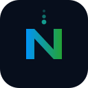

<p align="center">
  
</p>

<h1 align="center">neodysk</h1>

<p align="center"><strong>Your media library, streamed from Usenet — plus the search, indexer and watchlist features upstream 2.x does not plan.</strong></p>

<p align="center">
  <a href="https://github.com/DemianosHB/neodysk/releases"></a>
  <a href="https://github.com/DemianosHB/neodysk/actions/workflows/rust-ci.yml?branch=rust"></a>
  <a href="https://github.com/DemianosHB/neodysk/pkgs/container/neodysk-rust"></a>
  <a href="LICENSE"></a>
  <a href="https://discord.gg/DAya7W6QMa"></a>
</p>

<p align="center">
  <a href="rust/README.md">Product README</a> ·
  <a href="#fork-vs-upstream">Fork vs upstream</a> ·
  <a href="#quick-start">Quick start</a> ·
  <a href="rust/PORTING.md">Porting plan</a> ·
  <a href="https://www.infinidysk.com/">Docs (upstream)</a> ·
  <a href="https://github.com/infinidysk/infinidysk">Upstream</a> ·
  <a href="https://github.com/DemianosHB/neodysk/issues">Issues</a>
</p>

neodysk is a Usenet-backed virtual filesystem. Sonarr, Radarr and other Arr apps add it as a SABnzbd download client; your media server then reads the files over a native FUSE mount or WebDAV while neodysk streams them from your Usenet providers on demand — nothing is downloaded to disk first.

This repository is the **DemianosHB fork** of [infinidysk/infinidysk](https://github.com/infinidysk/infinidysk). The `rust` branch (the branch you are reading) is the fork's **Rust 2.x line**: upstream's 2.x rewrite, with the v1-only features ported back on top in Rust. The C# 1.x line lives on the [`v1`](https://github.com/DemianosHB/neodysk/tree/v1) branch and is maintenance-only.

> [!IMPORTANT]
> **This fork is vibe-coded.** It is developed with AI coding agents (Mistral Vibe), not hand-written commit by commit. Expect the code, commits and review depth to differ from upstream — use it at your own risk and please report issues you find.

## Fork vs upstream

The 2.x base is vendored from upstream `main` at `89db517` (with the `rapidyenc` submodule content inlined, so the tree builds standalone). On top, this fork ports the features upstream 2.x explicitly does not plan (see its [feature comparison](https://www.infinidysk.com/v2/whats-new/#feature-comparison)); the C# code on branch `v1` is the specification for them.

| Area | Upstream infinidysk 2.x | This fork (`rust` branch) |
|---|---|---|
| Indexer search (Newznab), Prowlarr pull-sync, search profiles | Not planned | **Ported** — `crates/indexer`, `crates/search`, `crates/profiles` |
| Stremio addon + Newznab adapter routes, play routes | Not planned | **Ported** — `/adapters/…`, `/api/search/…` in `crates/infinidysk` |
| Watchtower, Preflight, Warden (+ the Watchdog log behind them) | Not planned | **Ported** — `crates/db` + routes in `crates/infinidysk` |
| Web UI pages for all of the above | — | **Ported** — `rust/ui/src/pages/` |
| SOCKS5 outbound proxy with bypass list, for NNTP and indexer HTTP | — | **Ported** — `crates/proxy`, `proxy.socks5` / `proxy.socks5_bypass` |
| Read-ahead PAR2 repair (repair first, failover second) | PAR2 repair experiment only | **Ported** — `crates/stream/src/readahead.rs` |
| STRM handoff file permissions | `0644`/`0755` regression ([infinidysk#1969](https://github.com/infinidysk/infinidysk/issues/1969)) | Fixed: `0666`/`0777`, optional `imports.handoff_permissions` |
| Smaller v1 parity items | — | WebDAV idle timeout on streamed reads, play URLs built from the request host, unread-download tracking |

Per-feature port status — what is done and where it deviates from v1: [rust/PORTING.md](rust/PORTING.md).

Images and tags differ too: this fork publishes **`ghcr.io/demianoshb/neodysk-rust`** (pre-releases `v2-beta.NN`, each published tag also moving `latest`; `rust-dev` from manual workflow runs on `rust`), kept separate from upstream's `ghcr.io/infinidysk/infinidysk-next` and from this fork's v1 image `ghcr.io/demianoshb/neodysk`.

## Quick start

```yaml
services:
  neodysk:
    image: ghcr.io/demianoshb/neodysk-rust:latest
    container_name: neodysk
    restart: unless-stopped
    environment:
      PUID: 1000
      PGID: 1000
      TZ: Etc/UTC # your time zone, e.g. Europe/Oslo; the maintenance window follows it
    ports:
      - "3000:3000"
    volumes:
      - ./config:/config
      - /mnt:/mnt:rshared
      - /sys/devices/virtual/bdi:/sys/devices/virtual/bdi:rw
    devices:
      - /dev/fuse:/dev/fuse
    cap_add:
      - SYS_ADMIN
    security_opt:
      - apparmor:unconfined
```

Open `http://<host>:3000`, create the admin account, then add your providers. Do this before exposing the port to an untrusted network: until an admin exists, anyone who reaches the page can create one.

| | |
|---|---|
| **Port** | `3000`, shared by the UI, the SABnzbd API and WebDAV |
| **Mount** | The library is mounted at `/mnt/infinidysk` |
| **Image** | `ghcr.io/demianoshb/neodysk-rust`, for Linux x64 and arm64 |

Full walkthrough, mount and tag details: [rust/README.md](rust/README.md#quick-start).

## Branches

| Branch | Line | Image |
|---|---|---|
| [`rust`](https://github.com/DemianosHB/neodysk/tree/rust) (this branch) | Rust 2.x — active development, target for PRs | `ghcr.io/demianoshb/neodysk-rust` |
| [`v1`](https://github.com/DemianosHB/neodysk/tree/v1) | C# 1.x — bug fixes only | `ghcr.io/demianoshb/neodysk` |

## Inside this branch

| Path | What it is |
|---|---|
| [rust/README.md](rust/README.md) | Product README: features, status, full setup, development |
| [rust/PORTING.md](rust/PORTING.md) | Port plan and per-feature status of the v1 → Rust port |
| [rust/AGENTS.md](rust/AGENTS.md) | Rules for AI agents and humans working in `rust/` |
| [rust/DESIGN.md](rust/DESIGN.md) · [rust/PRODUCT.md](rust/PRODUCT.md) | UI design rules · product definition |
| [rust/crates/](rust/crates/) | The workspace: `infinidysk` (product binary) plus libraries — NNTP, yEnc, streaming, archives, PAR2, queue, health, Arr client, VFS, FUSE mount, WebDAV, database, search, indexer, profiles, proxy, 1.x importer |
| [rust/ui/](rust/ui/) | The web UI |

## Development

PRs target `rust` (1.x bug fixes go to `v1`); CI is the *Rust CI* workflow (`.github/workflows/rust-ci.yml`). Read [rust/AGENTS.md](rust/AGENTS.md) before changing anything — it also defines the commit conventions.

```sh
cd rust
cargo fmt --all --check
cargo clippy --workspace --all-targets --locked -- -D warnings
cargo test --workspace --locked
```

## Reporting problems

- **This fork's features** (search, Watchtower, …) and anything on the `rust` branch: [github.com/DemianosHB/neodysk/issues](https://github.com/DemianosHB/neodysk/issues)
- **Upstream behavior**: [github.com/infinidysk/infinidysk/issues](https://github.com/infinidysk/infinidysk/issues)

Include the image tag and a support pack from the System page. Never post provider passwords or API keys.

## Legal and responsible use

This software is a general-purpose, self-hosted tool: it streams whatever NZB content the Usenet providers and indexers you configure expose, using your own accounts. This repository hosts no content itself and does not provide, link to, or endorse any copyrighted material.

You are solely responsible for the content you access with it — only use it with content you have the legal right to download and stream in your jurisdiction. The maintainers do not condone piracy and will not support users suspected of engaging in copyright infringement.

If you believe material in this repository infringes your rights, please report it via [GitHub's DMCA takedown process](https://docs.github.com/en/site-policy/dmca-takedowns) or by opening an issue, and it will be acted on promptly.

## Credits

Many thanks to the [infinidysk](https://github.com/infinidysk/infinidysk) team and all upstream contributors — this fork builds entirely on their 2.x Rust rewrite and the v1 line it grew out of, and would not exist without their work.

## License

MIT — see [LICENSE](LICENSE).
